<!-- page-version: 1.0.0 status: draft last-reviewed: 2026-11-08 -->

# Diagrams

The logic of this project, visually. Every diagram here is Mermaid, so it renders in the
docs-viewer, diffs cleanly in review, and needs no build step.

Each diagram says what it shows and where the prose version lives. If a diagram and the prose
disagree, the prose in `SPEC.md` is authoritative and the diagram is the bug.

---

## D1: System context

The five layers, and what each is allowed to know about the others. The arrows point the way
information flows; nothing points back up.

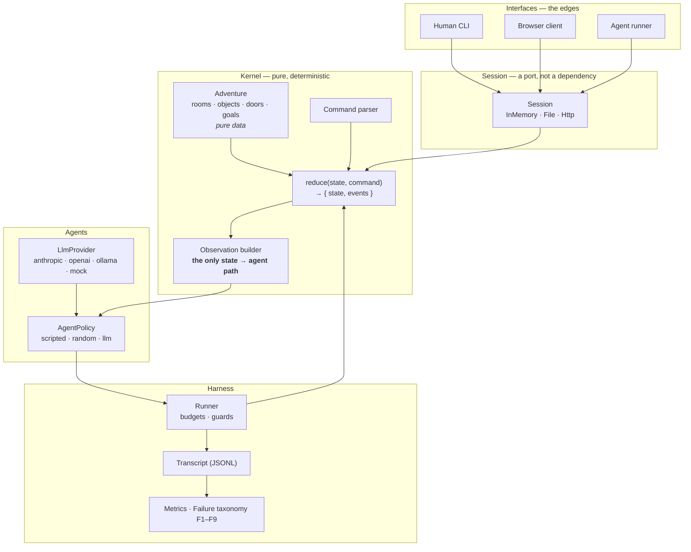

**The two rules the picture encodes.** The kernel sits alone in the middle with no arrows pointing
out of it except the observation builder. It cannot call anything, because it *is* a function. And
the observation builder is the only path from state to agent; the adventure's gold path, hint table
and action predicates have no arrow to the agent side at all, because the builder never receives
them.

Prose: `SPEC.md` §4.

---

## D2: The turn loop

The whole experiment, in one loop.

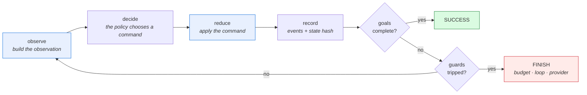

Note where the model is *not*: it appears once, in "decide". Everything else is the environment,
and the environment never consults the model.

Prose: `SPEC.md` §11.1.

---

## D3: Command resolution

What happens to a line of text. Every red exit is a recoverable failure the agent is told about.

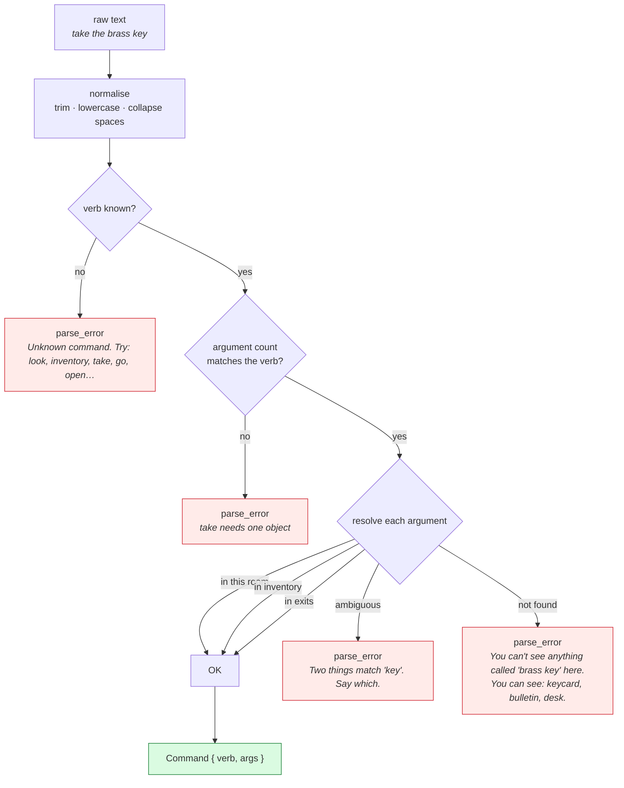

**The important property:** the parser never *fixes* the agent's intent. `take the brass key` fails
even though a keycard is present, because "brass" is not in the scenario's declared alias table.
If the parser guessed, the invalid-action rate would measure the parser instead of the agent.

Prose: `SPEC.md` §8.

---

## D4: Predicate and effect evaluation

How one action either happens or does not.

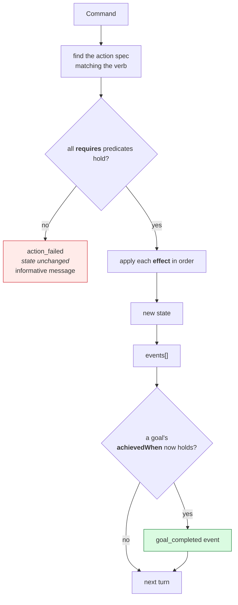

The predicate vocabulary is six kinds and the effect vocabulary is eight; both are listed in
`SPEC.md` §5.1. That is the entire engine.

Prose: `SPEC.md` §5.1, §6.

---

## D5: The adventure as a state machine

The whole Mission Impossible scenario, as states and transitions. This is the picture to check a
reading of the scenario against.

```mermaid
stateDiagram-v2
    [*] --> briefing

    briefing: BRIEFING ROOM
    corridor: SERVICE CORRIDOR
    vault: SERVER VAULT

    briefing --> corridor: go corridor
    corridor --> briefing: go briefing
    corridor --> vault: go vault<br/>(door locked)
    vault --> corridor: go corridor

    note right of corridor
        locker: closed
        → cutters, manual
        keypad: the safe code
    end note

    note right of vault
        bomb: 3 wires
        → cut the yellow one
        safe: locked, code 4821
        → case
    end note

    state "case recovered" as recovered
    state "bomb detonated" as boom
    state "mission complete" as won

    corridor --> recovered : take case
    vault --> boom : cut red or blue
    recovered --> won
```

The gold path walks this graph: `take keycard` · `go corridor` · `open locker` · `take cutters` ·
`read manual` · `unlock vault door with keycard` · `go vault` · `cut yellow wire with cutters` ·
`unlock safe with 4821` · `take case`.

Prose: `SPEC.md` §7.

---

## D6: One agent turn, as a sequence

Who calls whom, and in what order.

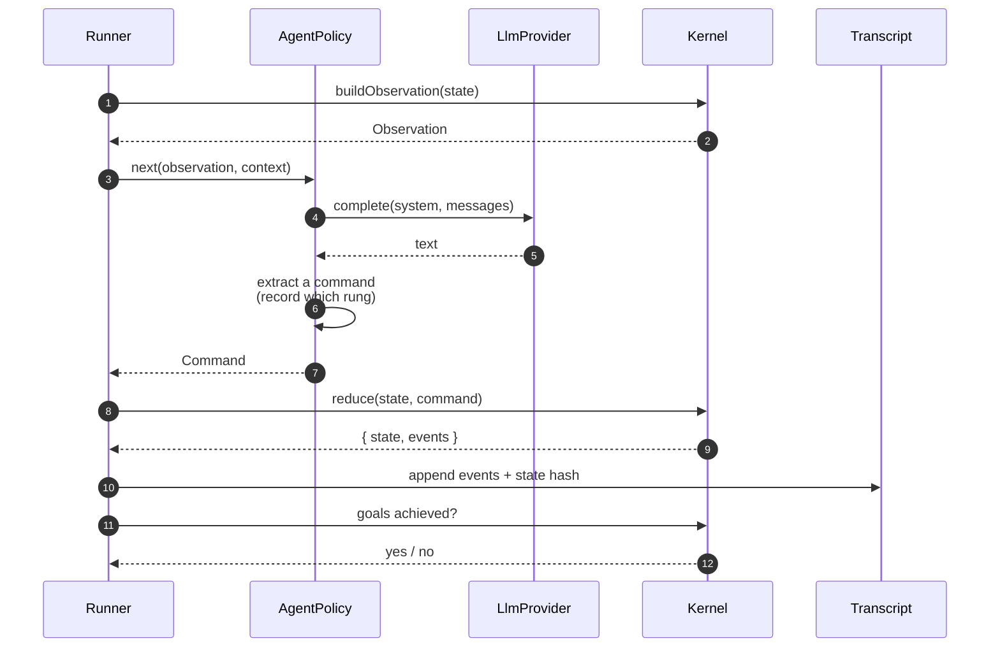

The provider is called exactly once per turn, and only when the policy needs it. The kernel is
never in the same conversation as the model.

Prose: `SPEC.md` §10, §11.1.

---

## D7: The leak boundary

The single most important picture in this document. The dashed line is the boundary the agent
cannot cross.

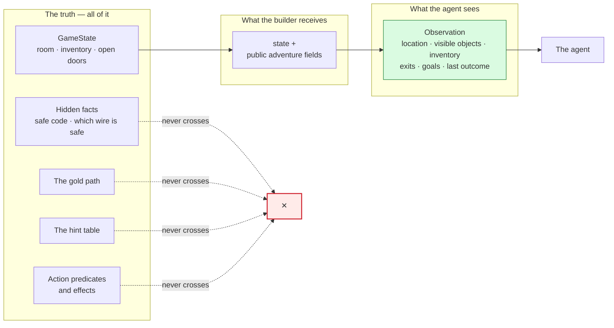

The enforcement is structural, not a promise: the builder's signature does not receive the hidden
facts, so it cannot pass them on. `tests/leakage.test.ts` then checks the property for every
reachable state.

Prose: `SPEC.md` §9, `experiments/exp-02-what-the-agent-sees/`.

---

## D8: Context strategies

The same observation, four ways. This is the variable that answers "do we give the agent the whole
conversation, or a summary of where it is?".

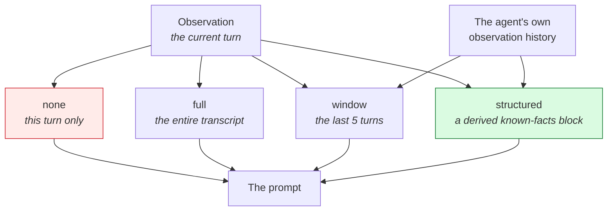

`structured` is highlighted because it is the recommended default: it is the Reflexion-style bounded
summary, and it is the shape an organisation-simulation agent would need. A dashboard, not a
transcript. `none` is the control.

Prose: `SPEC.md` §10.4.

---

## D9: Budgets and guards

Every way a run can end, and what each one means.

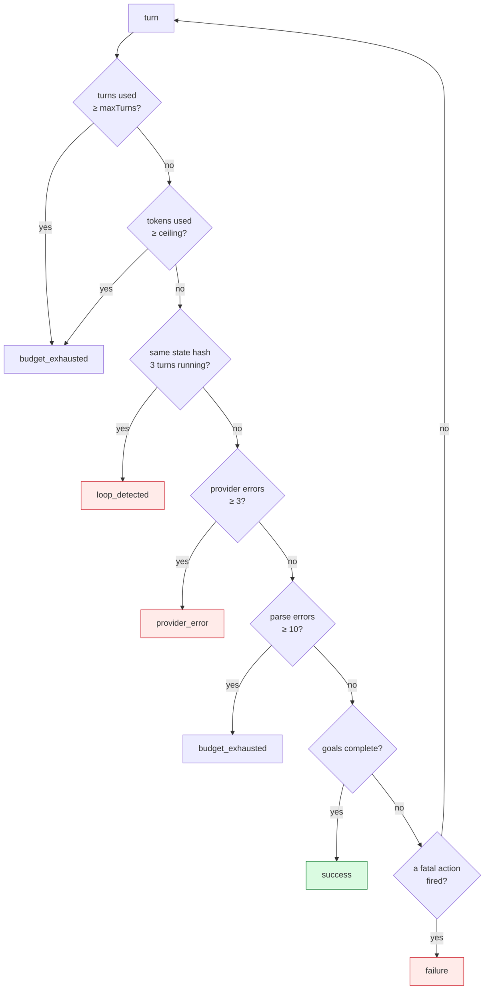

`budget_exhausted` is the most common honest outcome, and it is a result, not a bug. It means the
agent spent its turns without finding the facts it needed.

Prose: `SPEC.md` §11.2, §11.3.

---

## D10: Classifying a failure

The decision tree that turns a failed run into one category. It reads the transcript, never the
model.

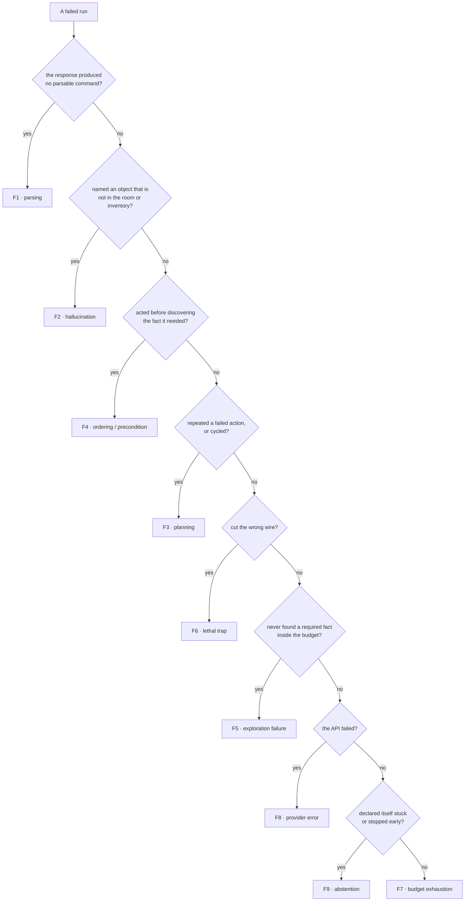

Exactly one category per failed run, applied in this priority order. The histogram this produces is
the project's primary artefact. See `experiments/exp-04-why-it-failed/`.

Prose: `SPEC.md` §12.3.

---

## D11: The sweep

From a matrix of models and conditions to a table of results.

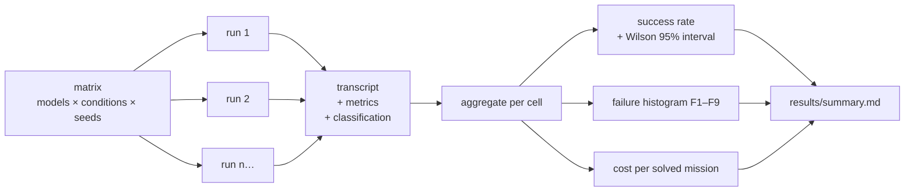

A cell with fewer runs than it was configured for is reported as **incomplete**, not averaged. A
partial cell silently averaged is how papers lie.

Prose: `SPEC.md` §12.4, §12.5.

---

## D12: Replay verification

How "the environment is deterministic" is proved rather than asserted.

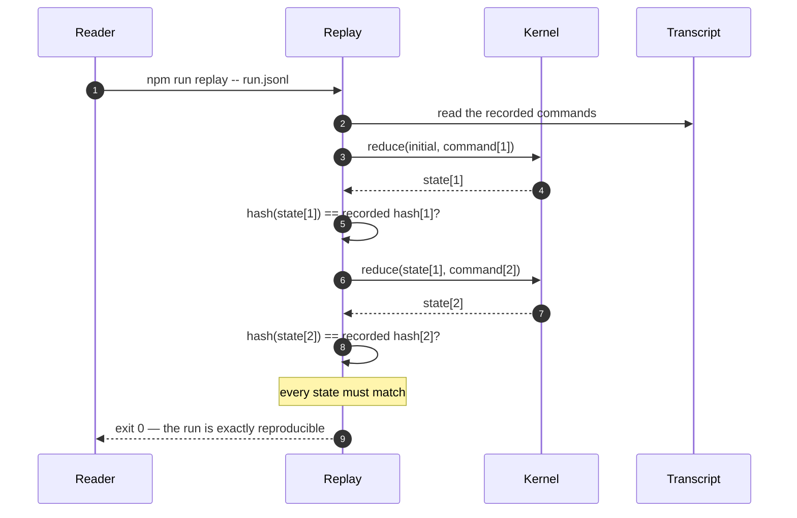

This is also the executable form of "one engine, three interfaces": the same command sequence must
produce the same hash chain through the human CLI, the browser client and the agent runner.

Prose: `SPEC.md` §13.2, §4.3.

---

## D13: The core data model

The types the kernel speaks, as a class diagram.

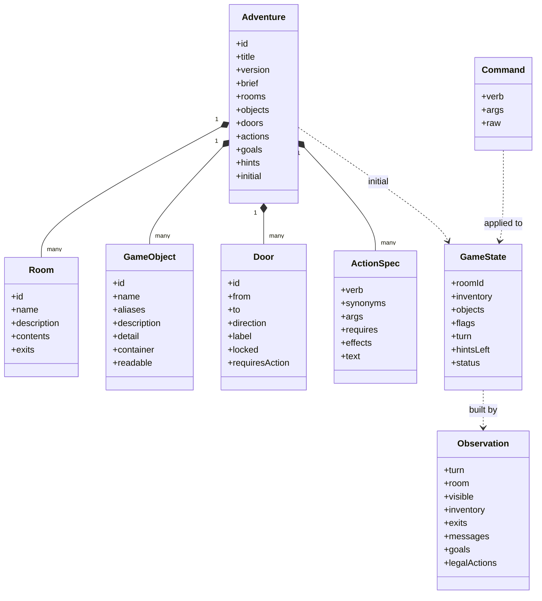

`Adventure` is data; `GameState` is a value; `Observation` is the *smaller* view of `GameState`.
The kernel never sees an `Observation` and the agent never sees a `GameState`.

Prose: `SPEC.md` §6.

---

## D14: How the build is ordered

The phases, and which experiment carries each one.

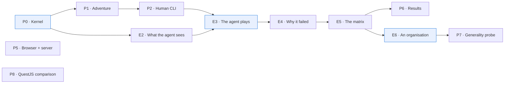

The critical edge is **E2 → E3**: the agent cannot be evaluated until you are certain it was never
told the answer. Everything after that is measurement.

Prose: `SPEC.md` §16, `experiments/README.md`.

---

## D15: Adventure → organisation

The mapping the whole project points at. The adventure vocabulary is not decoration; it is the
proposed model for an organisation, and Experiment 06 is where that claim gets tested.

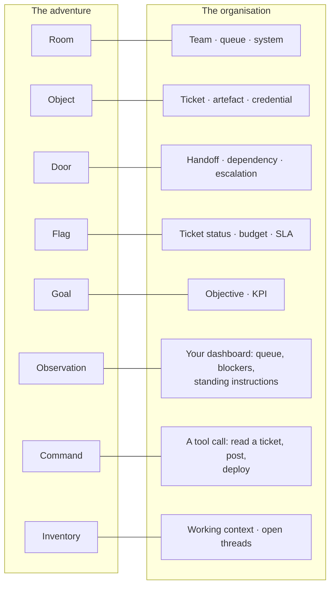

**The one thing that does not carry over:** in the adventure, the agent can *read* the manual and
learn the rule. In an organisation, some rules are written down and some are not. And an agent
that cannot tell the difference is the failure mode we actually care about.

Prose: `SPEC.md` §18.

---

## D16: One engine, three interfaces

The property that makes a human transcript a valid comparison for an agent transcript.

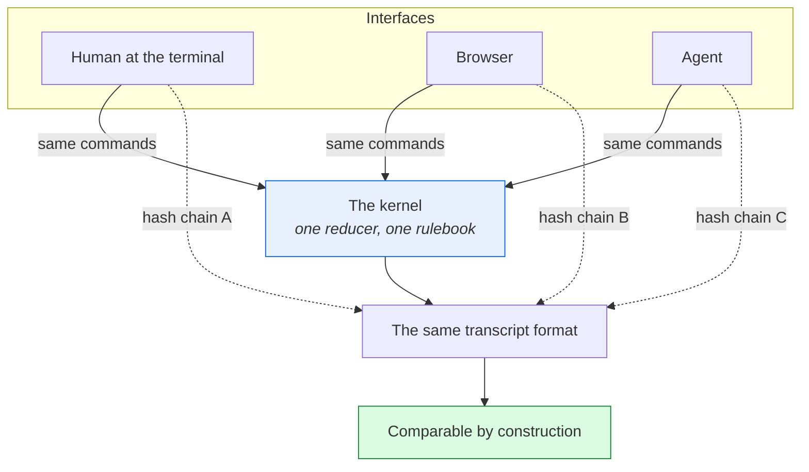

A human wins and the agent wins are then statements about the same world, measured the same way.

Prose: `SPEC.md` §4.3, §14.

---

## D17: Where the project goes next

From a text adventure to an organisation, and what each step costs.

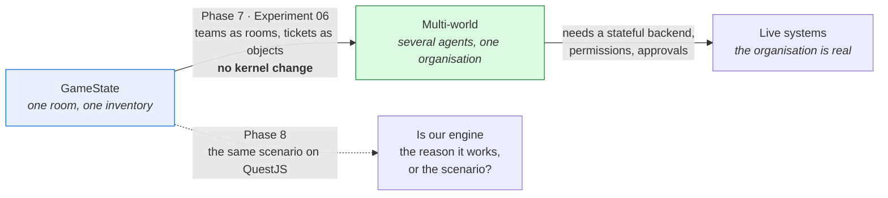

Phase 8 is a **control on our own work**: if the same agent scores the same on QuestJS, then our
results are about the agent and the scenario, not about our engine's design choices.

Prose: `SPEC.md` §18, §16 Phase 7–8.
