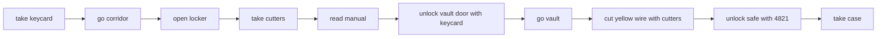

```mermaid
graph LR
  s1["claim incident ticket"]--> s2
  s2["go release engineering"]--> s3
  s3["open shared inbox"]--> s4
  s4["claim deploy credential"]--> s5
  s5["read release runbook"]--> s6
  s6["unlock release gate with incident ticket"]--> s7
  s7["deploy release-2.4.1 with deploy credential"]--> s8
  s8["go customer success"]--> s9
  s9["unlock customer handover with 7311"]--> s10
  s10["claim customer notification"]
```

# The maps

<!-- GENERATED FILE: run `npm run maps` after changing an adventure, an experiment or the phase plan. `npm run maps:check` fails when this file no longer matches the data. -->

Everything below is drawn from the repository: the rooms, doors, verbs and goals come from the adventure definitions, the gold paths come from the route each world ships, and the experiment list comes from the directories the series ships.

## The flow

```mermaid
graph TD
  p1["Kernel"]
  p1c1["T0.1 Project scaffolding"]
  p1 --> p1c1
  p1c2["T0.2 Kernel types and the DSL"]
  p1 --> p1c2
  p1c3["T0.3 Pure reducer"]
  p1 --> p1c3
  p1c4["T0.4 Hash chain and canonical JSON"]
  p1 --> p1c4
  p1c5["T0.5 Command parser"]
  p1 --> p1c5
  p1c6["T0.6 Observation builder"]
  p1 --> p1c6
  p1c7["T0.7 Renderers, goals, hints"]
  p1 --> p1c7
  p1c8["T0.8 Architecture boundary"]
  p1 --> p1c8
  p2["Adventure"]
  p2c1["T1.1 Adventure data"]
  p2 --> p2c1
  p2c2["T1.2 Prose and hints"]
  p2 --> p2c2
  p2c3["T1.3 Gold path and BFS oracle"]
  p2 --> p2c3
  p2c4["T1.4 Negative validation"]
  p2 --> p2c4
  p3["Human CLI"]
  p3c1["T2.1 CLI skeleton"]
  p3 --> p3c1
  p3c2["T2.2 Human play loop"]
  p3 --> p3c2
  p3c3["T2.3 Transcript writer"]
  p3 --> p3c3
  p4["Agent harness"]
  p4c1["T3.1 Provider port and adapters"]
  p4 --> p4c1
  p4c2["T3.2 Prompt assembly"]
  p4 --> p4c2
  p4c3["T3.3 Action extraction"]
  p4 --> p4c3
  p4c4["T3.4 Policies"]
  p4 --> p4c4
  p4c5["T3.5 Context strategies"]
  p4 --> p4c5
  p4c6["T3.6 Runner, budgets, guards"]
  p4 --> p4c6
  p5["Measurement"]
  p5c1["T4.1 Metrics"]
  p5 --> p5c1
  p5c2["T4.2 Failure classifier"]
  p5 --> p5c2
  p5c3["T4.3 Sweep and summary"]
  p5 --> p5c3
  p5c4["T4.4 Replay"]
  p5 --> p5c4
  p6["Web client and server"]
  p6c1["T5.1 Session ports"]
  p6 --> p6c1
  p6c2["T5.2 Server"]
  p6 --> p6c2
  p6c3["T5.3 Web client"]
  p6 --> p6c3
  p7["Results"]
  p7c1["T6.1 Run the matrix"]
  p7 --> p7c1
  p7c2["T6.2 Verify reproducibility"]
  p7 --> p7c2
  p7c3["T6.3 Write up"]
  p7 --> p7c3
  p8["Generality probe (stretch)"]
  p9["Engine comparison (stretch)"]
  a1[("results/exp-08")]
  p1 --> a1
  a2[("results/failures.md")]
  a3[("results/live")]
  a4[("results/live-org-turnbound")]
  a5[("results/live-turnbound")]
  a6[("results/summary.json")]
  a7[("results/summary.md")]
  a8[("results/transfer.json")]
  a9[("results/transfer.md")]
```



The phases and their cards, as the plan records them:

### Kernel

- T0.1 Project scaffolding
- T0.2 Kernel types and the DSL
- T0.3 Pure reducer
- T0.4 Hash chain and canonical JSON
- T0.5 Command parser
- T0.6 Observation builder
- T0.7 Renderers, goals, hints
- T0.8 Architecture boundary

### Adventure

- T1.1 Adventure data
- T1.2 Prose and hints
- T1.3 Gold path and BFS oracle
- T1.4 Negative validation

### Human CLI

- T2.1 CLI skeleton
- T2.2 Human play loop
- T2.3 Transcript writer

### Agent harness

- T3.1 Provider port and adapters
- T3.2 Prompt assembly
- T3.3 Action extraction
- T3.4 Policies
- T3.5 Context strategies
- T3.6 Runner, budgets, guards

### Measurement

- T4.1 Metrics
- T4.2 Failure classifier
- T4.3 Sweep and summary
- T4.4 Replay

### Web client and server

- T5.1 Session ports
- T5.2 Server
- T5.3 Web client

### Results

- T6.1 Run the matrix
- T6.2 Verify reproducibility
- T6.3 Write up

### Generality probe (stretch)


### Engine comparison (stretch)


The experiments, in the order the plan builds them:

- `exp-01-the-game`
- `exp-02-what-the-agent-sees`
- `exp-03-the-agent-plays`
- `exp-04-why-it-failed`
- `exp-05-the-matrix`
- `exp-06-an-organisation`
- `exp-08-the-engine-comparison`

The artefacts the series has produced:

- `results/exp-08`
- `results/failures.md`
- `results/live`
- `results/live-org-turnbound`
- `results/live-turnbound`
- `results/summary.json`
- `results/summary.md`
- `results/transfer.json`
- `results/transfer.md`

## Operation Nightingale

`mission-impossible` · 3 rooms · 14 objects · 4 doors · 19 verbs · 10-command gold path

Mission brief. A booby-trapped case is locked in the server vault. Two objectives: disarm the bomb, and recover the case. Nothing else is known. You are in the briefing room. Discover the rest by exploring.

### The rooms

```mermaid
graph LR
  briefing["Briefing Room<br/>keycard<br/>bulletin<br/>desk"]
  corridor["Service Corridor<br/>locker<br/>extinguisher<br/>vault_door"]
  vault["Server Vault<br/>bomb<br/>wire_red<br/>wire_blue<br/>wire_yellow<br/>safe"]
  briefing -->|service corridor| corridor
  corridor -->|briefing room| briefing
  corridor -->|vault door (locked)| vault
  vault -->|service corridor| corridor
```

### The gold path



| # | Command |
|---|---|
| 1 | `take keycard` |
| 2 | `go corridor` |
| 3 | `open locker` |
| 4 | `take cutters` |
| 5 | `read manual` |
| 6 | `unlock vault door with keycard` |
| 7 | `go vault` |
| 8 | `cut yellow wire with cutters` |
| 9 | `unlock safe with 4821` |
| 10 | `take case` |

### The verbs

| Verb | Also | Takes |
|---|---|---|
| `look` | , l, look around |  |
| `inventory` | , i, inv, carrying |  |
| `help` | , ? |  |
| `wait` | , z |  |
| `hint` | , h |  |
| `examine` | , x, inspect, look at | target |
| `read` | , study | target |
| `read` | , study | target |
| `take` | , get, grab, pick up | target |
| `open` |  | target |
| `unlock` |  | target, with |
| `unlock` |  | target, with |
| `cut` | , snip | target, with |
| `cut` | , snip | target, with |
| `cut` | , snip | target, with |
| `go` | , walk, move, head | target |
| `go` | , walk, move, head | target |
| `go` | , walk, move, head | target |
| `go` | , walk, move, head | target |

### The goals

| Goal | What it asks |
|---|---|
| disarm | Disarm the bomb |
| recover | Recover the case |

## The 2.4.1 Hotfix

`hotfix-2-4-1` · 3 rooms · 11 objects · 4 doors · 19 verbs · 10-command gold path

The customer SLA expires at 17:00 and the 2.4.1 hotfix is not shipped. Two objectives: ship the hotfix, and notify the customer. Nothing else is known. You are platform on-call. Discover the rest by exploring.

### The rooms

```mermaid
graph LR
  platform["Platform On-call<br/>incident_ticket<br/>oncall_board"]
  release_engineering["Release Engineering<br/>inbox<br/>release_2_3_9<br/>release_2_4_0<br/>release_2_4_1<br/>release_gate"]
  customer_success["Customer Success<br/>customer_handover"]
  platform -->|release engineering| release_engineering
  release_engineering -->|platform on-call| platform
  release_engineering -->|customer success (locked)| customer_success
  customer_success -->|release engineering| release_engineering
```

### The gold path



| # | Command |
|---|---|
| 1 | `claim incident ticket` |
| 2 | `go release engineering` |
| 3 | `open shared inbox` |
| 4 | `claim deploy credential` |
| 5 | `read release runbook` |
| 6 | `unlock release gate with incident ticket` |
| 7 | `deploy release-2.4.1 with deploy credential` |
| 8 | `go customer success` |
| 9 | `unlock customer handover with 7311` |
| 10 | `claim customer notification` |

### The verbs

| Verb | Also | Takes |
|---|---|---|
| `look` | , l, look around |  |
| `inventory` | , i, inv, carrying, context |  |
| `help` | , ? |  |
| `wait` | , z |  |
| `hint` | , h |  |
| `examine` | , x, inspect, look at | target |
| `claim` | , take, get, pick up | target |
| `read` | , study | target |
| `read` | , study | target |
| `open` |  | target |
| `unlock` |  | target, with |
| `unlock` |  | target, with |
| `deploy` | , ship, release | target, with |
| `deploy` | , ship, release | target, with |
| `deploy` | , ship, release | target, with |
| `go` | , walk, move, head | target |
| `go` | , walk, move, head | target |
| `go` | , walk, move, head | target |
| `go` | , walk, move, head | target |

### The goals

| Goal | What it asks |
|---|---|
| ship | Ship the 2.4.1 hotfix |
| notify | Notify the customer |
