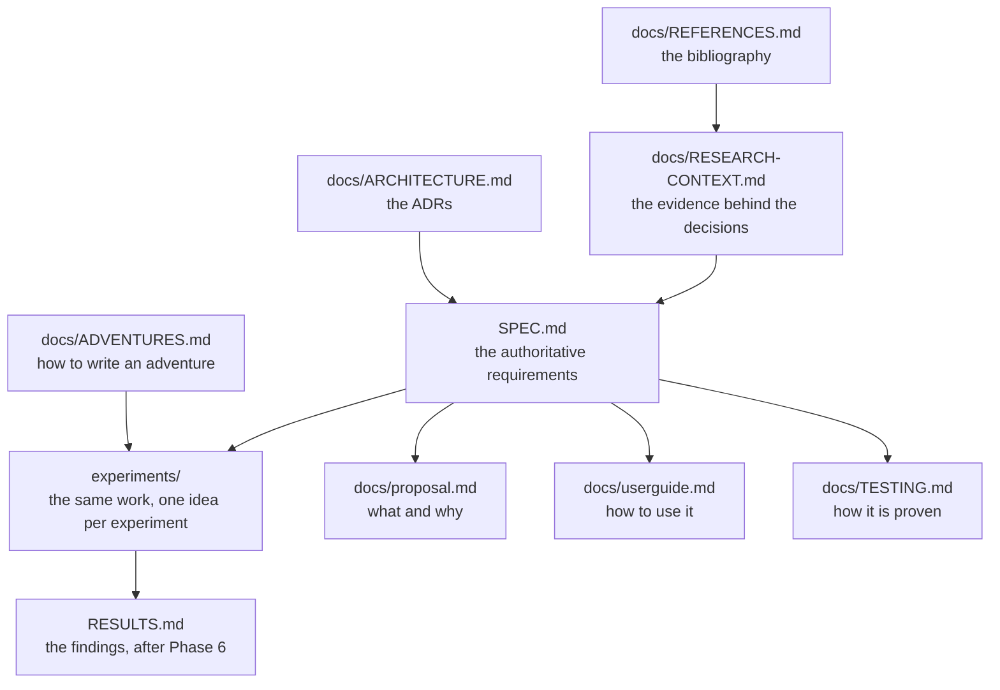

<!-- page-version: 1.0.0 status: draft last-reviewed: 2026-11-08 -->

---
title: research-text-adventure-ai. Docs guide
status: living document
last-updated: 2026-11-07
---

> **This is a living document.** Keep it in sync with reality. If a
> decision changes, or a gap emerges that this doc didn't anticipate,
> update the relevant section (and add an entry to the decisions log).

# research-text-adventure-ai: docs guide

*Four documents and a glossary can be read in the wrong order very easily. This one is the map that
stops that happening.*

## Onboarding: start here

Read in this order. The first two documents are enough to understand the entire project; the rest
is detail you only need when you are building or reviewing.

1. **[`SPEC.md` Part 0, Orientation](../SPEC.md#part-0-orientation)**, teaches the
   idea from the beginning: the question, why a text adventure, the six words the design rests on,
   one full turn end to end, and how we will know whether it worked. Start here.
2. **[`experiments/README.md`](../experiments/README.md)**. The work, re-cut as a numbered series
   where each experiment teaches one idea and runs on its own. This is the path for building.
3. **[`docs/proposal.md`](./proposal.md)**. What the project is, what it deliberately is not, and
   the decisions log.
4. **[`docs/userguide.md`](./userguide.md)**. How to play the adventure and run the agent.
5. **[`docs/TESTING.md`](./TESTING.md)**. The testing doctrine and what each layer guarantees.
6. **[`AGENT_BRIEF.md`](../AGENT_BRIEF.md)**. The copy-paste brief for an agent picking up the work.

## How it fits together

**The rule that keeps this from rotting.** `SPEC.md` is authoritative for *detail*. The experiment
READMEs are authoritative for *intent*. The living documents under `docs/` are authoritative for
*the story*. What the project is, how to use it, how it is proven. When two disagree, the
specific one wins for its own subject and the disagreement gets fixed.

## How we got here

The project started as a question about AI agents in stateful environments and grew a shape from
the research rather than the other way round.

- **The engine survey** found good options, QuestJS, ink, TextWorld, and rejected them for one
  reason: the observation surface, which is the variable under test, would belong to someone
  else's engine. `docs/RESEARCH-CONTEXT.md` §2.
- **The benchmark calibration** found TALES, where the same models score 76–100 on synthetic games
  and 13.4 on human-written ones. And whose authors attribute the collapse to grounded and
  inductive reasoning failures. That is what this project is built to measure locally.
  `docs/RESEARCH-CONTEXT.md` §3.
- **The reversal.** An early draft kept the kernel deliberately domain-neutral so it could be
  pointed at other worlds. That was over-engineering: it made the code harder to read without
  making the organisation simulation any easier. The kernel now speaks the adventure's own
  vocabulary, and the organisation becomes *another adventure*. ADR-002 (superseded) and ADR-016.
- **The re-cut.** The phase plan was sound but not teachable. Re-cutting it as a numbered
  experiment series, each one idea, each independently runnable, each built test-first, made the
  order of work match the order of understanding.

## Reference: where to find everything

| I want to… | Go to |
|---|---|
| Understand the project | [`SPEC.md` Part 0](../SPEC.md#part-0-orientation) |
| Know what to build, and in what order | [`experiments/README.md`](../experiments/README.md) |
| Build the kernel and the adventure | [`experiments/exp-01-the-game/`](../experiments/exp-01-the-game/README.md), [`SPEC.md` §6–§7](../SPEC.md) |
| Write a new adventure | [`docs/ADVENTURES.md`](./ADVENTURES.md) |
| Know why a design decision was made | [`docs/ARCHITECTURE.md`](./ARCHITECTURE.md) (ADRs) and [`docs/RESEARCH-CONTEXT.md`](./RESEARCH-CONTEXT.md) §6 |
| Check a citation | [`docs/REFERENCES.md`](./REFERENCES.md) |
| See how to play | [`docs/userguide.md`](./userguide.md) |
| Know what is proven and how | [`docs/TESTING.md`](./TESTING.md) |
| Track the work | The GitHub issues and milestones on `gyrum-labs/research-text-adventure-ai` |
