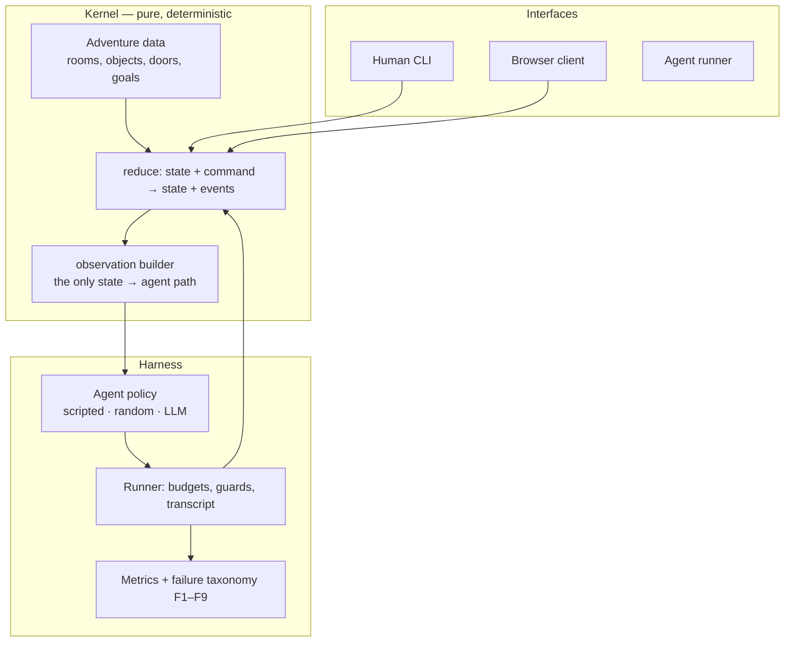

<!-- page-version: 1.0.0 status: draft last-reviewed: 2026-11-08 -->

---
title: research-text-adventure-ai. Project proposal
status: living document
last-updated: 2026-11-07
---

> **This is a living document.** Keep it in sync with reality. If a decision changes, or a gap emerges that this doc didn't anticipate, update the relevant section (and add an entry to the decisions log).

# research-text-adventure-ai: project proposal

*Every version of this proposal started with an adventure game, and every version of it was
running away from the fact that the game was the point rather than the excuse. This one tries to
say what the game is for.*

## Concept
> **Reader track**
>
> - **Five minutes.** The Concept and the Scope. That is the proposal.
> - **Twenty minutes.** Add the Architecture and the Decisions log.
> - **An hour.** Read it with `SPEC.md` Part 0 beside you.

**The question.** Can a large language model drive itself through a task that has rules. Without
being told the answer, and without being able to talk its way past a locked door?

We build a small text adventure: three rooms, nine objects, a locked vault, a bomb, and a
10-command solution. An AI model is dropped into it with only the mission brief and the rules of
the game. We record everything it does, then say something honest about how reliable AI agents
are when the work is *stateful*. When what happened three moves ago decides what is possible now.

**Why a text adventure.** Because the world checks. A model can produce a confident, fluent,
wrong answer in one shot; a game will not let it. If the model claims to have disarmed the bomb,
the bomb's state says otherwise. That makes the game a laboratory rather than a demo: the same
run can be replayed exactly, and a finding can be checked rather than trusted.

**Who it is for.** A team deciding whether an LLM agent can be trusted with organisation-shaped
work. A queue, a handoff, a dependency, an objective with a deadline. The game is the
scaled-down rehearsal. `SPEC.md` §18 maps the vocabulary across: teams become rooms, tickets
become objects, handoffs become doors.

**What the first working version does.** A human plays the adventure at the terminal, an agent
plays the same adventure with no extra help, and the repo publishes the difference: how often the
agent finishes, how many turns it took, what it cost, and, the artefact that matters most, which
of nine failure categories each unsuccessful run fell into.

## Architecture

Three properties hold everywhere and are tested rather than asserted:

- **The kernel is pure.** No I/O, no clock, no randomness. The same commands always produce the
  same state, so every run replays to an identical hash chain.
- **The agent is never told more than it earned.** One function builds the agent's view, and it
  never sees the gold path, the hint table, or a closed container's contents.
- **One engine, three interfaces.** The human, the browser and the agent drive the same reducer,
  so "the agent solved it" means exactly what "a human solved it" means.

## Scope

**In scope for the first version.** The kernel, one adventure, the human CLI, the agent harness
with at least two model providers, the measurement harness, and a results write-up with a failure
taxonomy and cost per solved mission.

**Deliberately out of scope.**

| Not doing | Why |
|---|---|
| Adopting an existing adventure engine | The observation surface, the variable under test, would be decided by someone else's engine. `docs/RESEARCH-CONTEXT.md` §2. |
| A browser game with graphics | The state machine is the thing; rendering is not. |
| Training or fine-tuning a model | This evaluates. |
| A live organisation simulation | Phase 7 asks whether the metaphor holds before anyone builds on it. |
| A multi-agent or concurrent simulator | One agent, one world, one clean measurement first. |

**Not a claim.** One hand-built adventure is a narrow claim. `SPEC.md` §17 lists the threats to
validity honestly, and the experiment series adds a second world before any generalisation is
asserted.

## Open questions

| Question | How it gets answered |
|---|---|
| Does the `structured` context strategy beat the full transcript? | Experiment 05, condition C against A. |
| Does masking legal actions help a modern model? | Experiment 05, condition C against B. |
| Does the failure taxonomy transfer to a second, very different world? | Experiment 06. |
| What is the real cost per solved mission? | Experiment 05, reported per cell. |
| Can the adventure metaphor express an organisation at all? | Experiment 06. And if it cannot, that is a finding, not a failure. |

> **Key takeaways**
>
> - The environment is the thing under suspicion. Build it first, and prove it.
> - The agent's view of the world is smaller than the world. That gap is the experiment.
> - One engine, three interfaces. A human run and an agent run mean the same thing.
> - The failure category is the finding. A bare success rate cannot tell you what to fix.
> - The organisation is the destination. The adventure is the rehearsal.

## Decisions log

| Date | Decision | Why |
|---|---|---|
| 2026-11-07 | Build a custom kernel instead of adopting QuestJS, ink or TextWorld | The observation surface is the variable under test; coupling it to an engine surrenders the experiment. `docs/RESEARCH-CONTEXT.md` §2. |
| 2026-11-07 | The kernel speaks the adventure's vocabulary. Rooms, objects, doors, flags | An organisation is to be modelled *as* an adventure. A neutral abstraction would have to be taught to every reader and every agent. ADR-016. |
| 2026-11-07 | The failure taxonomy is a first-class deliverable, not a footnote | "Diagnosis is the primary bottleneck" in the literature; a bare success rate cannot tell you what to fix. `SPEC.md` §12.3. |
| 2026-11-07 | Build the work as a numbered experiment series, test-first | Each experiment teaches one idea and is independently runnable; the environment must be provably trustworthy before the agent is measured. `experiments/README.md`. |
| 2026-11-07 | The command parser never repairs the agent's intent | Otherwise the invalid-action rate measures the parser instead of the agent. `SPEC.md` §8.2. |
