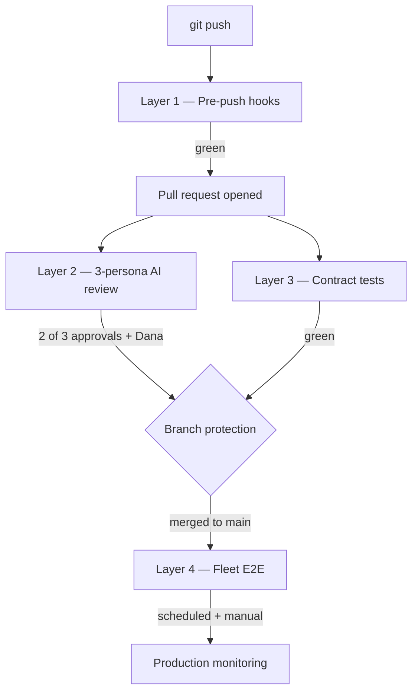

<!-- AUTO-GENERATED from gyrum-labs/devtools docs/shared/check-stack.md. Do not edit directly. Run scripts/update-docs.sh to refresh. -->

# The check stack

Every gyrum project catches bugs in four places. Unit tests run on a developer's laptop before the push leaves the machine. An AI review panel reads the diff before a human does. Contract tests validate that each service's HTTP surface still matches the OpenAPI spec it promises. Fleet end-to-end tests drive real browsers against real composed services and catch the integration bugs that only exist when the pieces are wired together. This document is the single authoritative description of all four layers — what each one catches, what it misses, how to run it, and how to decide which layer a new test belongs in.

The document exists because a real bug recently passed every layer we had at the time and was only caught when a human loaded the browser. A playbook runtime that should have substituted `${inputs.X}` did not; the unit tests did not exercise the substitution path, the AI panel approved the diff, and contract tests for the playbook runtime did not yet exist. The browser-level failure was not a freak event — it was the predictable consequence of not having written down which bugs each layer is responsible for. Writing it down, and telling every engineer where to add the next test, is the fix.

## Overview — the four layers



| Layer | Runs | Speed | Blast radius | What it catches |
|-------|------|-------|--------------|-----------------|
| 1. Pre-push hooks | Every `git push` | ~15s | Single repo | Compile, lint, unit tests, complexity, coverage, secrets, file size |
| 2. 3-persona AI review | Every PR | ~90s | Single repo | Architecture drift, security holes, TDD discipline, Go idioms |
| 3. Contract tests | CI per PR | ~30s | Service API | Response-shape drift, status codes, required fields |
| 4. Fleet E2E | CI scheduled + manual | ~5min | Cross-service | Integration bugs, SSR quirks, CORS, cross-repo deploys |

The layers are ordered by cost and by the scope of the failure each one can see. Layer 1 is cheap, runs on every push, and only sees the single repo. Layer 4 is expensive, runs on a schedule, and sees every service in the fleet at once. A bug that only shows up when two services talk to each other will never be caught by layer 1, no matter how thorough the unit tests are; a bug in a pure function will be caught by layer 1 long before layer 4 gets anywhere near it. Each layer is there because the layers above it cannot catch what it catches, and running any subset of them without the others leaves a class of bug uncovered.

The rest of this document walks the layers in order, explains what each one can and cannot see, and finishes with a decision table for picking the right layer when you are writing a new test.

## Layer 1 — Pre-push hooks

The first layer is a set of fast mechanical checks that run on every `git push` through the `pre-push` hook that `gyrum-setup` installs. A cheap subset — build and test — runs locally on the developer's laptop before the push leaves the machine, so obviously broken commits are caught before anyone else sees them. The full suite (linters, coverage, secret scans, complexity limits, security scanners) runs inside `gyrum-review-pr` and is what the gate actually enforces. The split is deliberate: the hook stays fast enough that nobody is tempted to bypass it, and the expensive checks run once, at review time, where their output is read.

### What it catches

This layer is deliberately mechanical. It only asks questions that have objective answers — *did the build succeed?*, *are there any secrets in the diff?*, *is this new file under the file-size threshold?* — and it refuses to compromise on them. If it passes, you know the code builds and runs its tests, which is the floor below which nothing merges.

<!-- consumer may not have .gyrum/debt-thresholds.json yet — overridable per-project, optional -->
<!-- doc-truth: ignore-next -->
The [`gate-stack.md`](./gate-stack.md) document is the authoritative list of every check that runs in this layer and whether it is blocking or warn-level. In broad strokes: `go build` / `npm run build`, `go test` / `npm test`, `staticcheck` / `eslint`, `shellcheck`, `gofmt`, `go mod tidy`, diff coverage on changed statements, cyclomatic complexity on new functions, file and PR size caps, secret scans, `gosec` / `govulncheck`, the viewer-validator on `docs/`, and a handful of warn-level signals (debug statements, `any`/`interface{}` net delta, lint-suppression net delta, skipped tests added). Every numeric threshold lives in `lib/thresholds.conf` in the devtools checkout, and can be overridden per-project via `.gyrum/debt-thresholds.json`.

### What it misses

Unit tests can only catch what their authors thought to test. The `${inputs.X}` substitution bug that motivated this document is the canonical example: the unit tests for the playbook runtime existed and were green, but none of them exercised the substitution path. Layer 1 cannot tell you that your tests are covering the wrong code — it can only tell you that the code they *do* cover is behaving the way the test expects.

Layer 1 also never sees more than one repo at a time. A change to a service's response shape can be perfectly consistent with that service's tests and still break every caller in the fleet. Layer 1 has no way to know that another service is a caller, so it cannot warn you.

### Where config lives

<!-- consumer may not have .gyrum/debt-thresholds.json yet — overridable per-project, optional -->
<!-- doc-truth: ignore-next -->
The hook itself is `pre-push.sh` in the devtools checkout, installed into each project as `.git/hooks/pre-push` by `gyrum-setup`. The full suite is `review-pr.sh`, also in devtools, invoked by `gyrum-review-pr`. Thresholds live in `lib/thresholds.conf`. To add a new check, extend the hook; to change a threshold, edit `lib/thresholds.conf` (or override per-project in `.gyrum/debt-thresholds.json`).

### What the gate does NOT block on

Two classes of failure are deliberately downgraded from blocking to advisory, because treating them as blocking used to feed the silent-admin-merge path in `gyrum-complete-pr` (see [Layer 2 — review refuses silent admin-merge](#layer-2--3-persona-ai-review) below).

*Pre-existing doc violations in unchanged files.* The viewer-validator is scoped to files the PR actually touches (`--changed-only --base-ref origin/<base>`). Unchanged files under `docs/` with pre-existing rule breakage do not fail an orthogonal PR. Project-wide checks (`index-registration`, `ui-screenshot-missing`, `template-placeholder`) still run against the full tree because their signal is structural, not per-file. Fresh clones that cannot resolve the base ref fall back to the full-repo scan — no silent pass.

*Private-module fetch failures in ephemeral clones.* When `go build`, `go test`, or `go mod tidy` fail with an authentication/403/401 error against a `gyrum-labs/*` module and no Personal Access Token (PAT — the GitHub credential a CI runner or fresh clone needs to fetch private modules) is available, the gate emits `⚠ (private modules unreachable — no PAT; skipped)` and does **not** fail. Real build errors, auth failures on non-gyrum modules, and tidy-drift all still block.

### How to bypass

You do not. `--no-verify` is forbidden by `CLAUDE.md` in every gyrum repo, and every devtools script refuses to run with it. A hook failure is the gate doing its job; silencing it ships the bug. Fix the root cause.

## Layer 2 — 3-persona AI review

The second layer is a panel of AI reviewers that reads the diff with the attention of an experienced engineer who cares whether the change is maintainable a year from now. It runs after layer 1 goes green — there is no point asking a reviewer to read a diff whose tests fail — and runs on every pull request through `gyrum-review-pr`.

### The personas

Four voices sit on the panel. Three are formal reviewers who cast votes that count toward branch protection; one is advisory.

*Priya Sharma* is the security reviewer. She reads the diff for exploitable problems — injection points, missing input validation, leaked secrets, broken authentication or authorisation — and for over-engineering that adds attack surface without earning it. Her bar is concrete problems a realistic attacker could use, not theoretical concerns.

*Marcus Chen* is the architecture reviewer. He watches the shape of the code rather than its line-level details. A domain package importing infrastructure, a feature reinventing something gyrum tooling already provides, a change that quietly breaks a public contract — those catch his attention. He blocks when a change damages the structure of the codebase.

*Lin* is the quality reviewer. Her focus is the discipline that keeps the code honest: new public code must come with tests, new exported symbols must carry documentation, and reachable runtime errors must be fixed before the change lands. She blocks on missing tests for new behaviour and on concrete quality regressions.

*Dana Okafor* is the documentation reviewer, and she is advisory. She reads every change from the perspective of a newcomer who has to understand it from the docs and the PR description alone. Her verdict gates `gyrum-review-pr`'s local exit code, so the script cannot pass without her approval, but it does not count toward GitHub's formal approval threshold. The reason for the split is operational: Dana shares a GitHub account with Lin, and posting her verdict as a formal review would overwrite Lin's approval. Her feedback is posted as a standard PR comment, clearly labelled as an advisory documentation review.

### Branch protection threshold

A pull request passes layer 2 when at least two of the three formal reviewers (Priya, Marcus, Lin) have approved *and* Dana's advisory verdict is a pass. GitHub will not let the author approve their own PR, so the author's opinion never counts toward the two-of-three total. This two-of-three threshold is the fleet standard — every gyrum repo configures `required_approving_review_count: 2` on its protected branches.

### What it catches

Layer 2 catches the failures that layer 1 cannot see because they are not objective. A confusing explanation in a new doc, a domain package that has started importing infrastructure, a public function with no test for its error path, a change that is technically correct but would be a nightmare to maintain — those are what the personas are for.

The `${inputs.X}` bug is a useful stress test for what the AI panel does and does not catch. The panel approved the diff. In retrospect the missing substitution was visible in the diff, but none of the three formal reviewers are chartered to verify end-to-end runtime behaviour — Priya looks for exploitable problems, Marcus looks for structural damage, Lin looks for missing tests. A missing substitution that the tests did not cover fell into a gap between personas: Lin would have flagged it if she had been told the feature was "template substitution", but from the diff alone it looked like a routing change with tests attached.

### Common failure modes

The most common known flake is **hallucinated ghost code on truncated diffs**. When a diff is larger than the model's effective context window, the reviewer sometimes invents references to functions or files that do not exist in the actual diff. The symptom is a reviewer quoting a line of code that `grep` cannot find. The fix is to shrink the PR — PR size caps in layer 1 exist precisely to keep this from happening — or, if the PR is legitimately large, to re-run `gyrum-review-pr` and confirm the feedback is reproducible before acting on it.

The second common failure is **rubber-stamp approval on trivial-looking diffs**. A three-line change to a config file reads as low-risk, and the reviewer approves quickly. The mitigation is that layer 1 runs first: a three-line change that breaks the build is caught before the reviewer ever sees it.

### How to resolve a review conflict

You fix the underlying issue and push a real quality improvement. You do *not* dismiss a review via the GitHub API, and you do *not* submit reviews yourself using a persona PAT. Both paths are flagged by `gyrum-review-pr` as review-tampering and counted against the PR rather than for it. If the panel is wrong, the right answer is to push a commit that demonstrates it is wrong (adds the missing test, clarifies the doc, reverts the structural change) and let the next review pass see the new code.

### `gyrum-complete-pr` refuses silent admin-merge

The merge step is now explicit, not a cascade. `gyrum-complete-pr` reads the PR's `reviewDecision` from GitHub before it tries to merge:

| reviewDecision | behaviour |
|----------------|-----------|
| `APPROVED` | merge with `--squash`/`--merge` as configured |
| `CHANGES_REQUESTED` | exit 1, refuse to merge |
| `REVIEW_REQUIRED` (no approvals yet) | exit 1, refuse to merge |
| empty / unknown | exit 1, refuse to merge |

There is no silent fall-through to `--admin`. If a reviewer persona produced a false-positive that genuinely needs to land anyway, the operator must invoke `gyrum-complete-pr --admin "<reason>"` — the reason is mandatory, and every admin-merge appends a line to `~/.gyrum/admin-merges.log` for audit. A bare `--admin` with no reason is refused. This was introduced after six PRs the week of 2026-04-22 silently admin-merged because the old `gh pr merge || gh pr merge --admin` cascade treated "no approval" and "branch protection violation" as the same signal.

The authoritative description of the panel — how verdicts are counted, how Dana's split works, which PAT each persona uses — is in [`gate-stack.md`](./gate-stack.md). This section is the summary; that file is the detail.

## Layer 3 — Contract tests

The third layer is new, shipped alongside Warp v1, and catches a class of bug that neither unit tests nor the AI panel can see: response-shape drift in a service's HTTP API. A unit test validates that a handler behaves correctly for a given input; a contract test validates that the handler's response still matches the OpenAPI specification the service has published to its callers. When the two diverge — a field renamed in the response but not in the spec, a status code changed from 200 to 204, a required field dropped — the unit test passes because it asserts against the actual response, and the callers break because they asserted against the spec.

### What it catches

Contract tests catch *exactly* the failures layer 1 unit tests cannot see by construction: the disagreement between a service's declared contract and its actual behaviour. Common shapes of that bug:

- A field is renamed in the response body; callers that parse the old name get `null`.
- A required field is made optional; callers that assume presence crash on absence.
- A status code changes; callers that switch on status hit the default branch.
- A new required field is added to a request body; old callers send a payload the server now rejects.
- A response changes from JSON to an error redirect under an edge condition; callers that always parse JSON fail on the error path.

None of those bugs are visible from a single unit test, because the unit test reads the actual response. All of them are visible from a contract test, because the contract test compares the actual response to the OpenAPI schema.

### What it misses

Contract tests are per-service. They do not run the *caller* against the *provider* — they only verify the provider still matches its own spec. If the caller and provider both update their spec consistently but the caller's code still reads the old field name, the contract tests on both services pass and the bug ships. Catching that failure is layer 4's job.

Contract tests also cannot catch logic bugs in a handler that returns a response matching its spec but computing the wrong value. A handler that is supposed to return the sum of two numbers and returns their product has the same response shape; the contract test cannot tell. That bug belongs to layer 1 or layer 4 depending on whether it is observable from inside the service or only across service boundaries.

### Where they live and how to run them

The reference implementation lives in `warp/contract/` as a separate Go module — separate so the contract test suite can be run against any build of the service, including a historical or v2 build, without pulling in that build's implementation dependencies. The module exposes a `make test-contract` target that runs the suite against a locally started service, and a `make test-contract-docker` target that runs it against a containerised build. Both are wired into the service's CI to run on every pull request.

To add coverage for a new endpoint, two steps:

1. Add the OpenAPI operation to the service's spec file (usually `openapi.yaml` at the repo root or under `api/`).
2. Add a contract test to `contract/` that exercises the endpoint and verifies the response against the spec. The reference suite uses [`kin-openapi`](https://github.com/getkin/kin-openapi) to parse the spec and validate responses against it, so the test is typically fewer than twenty lines.

<!-- cross-repo path — gyrum-labs/warp; resolves in that repo, not the consumer -->
<!-- doc-truth: ignore-next -->
See `warp/contract/README.md` for the detailed pattern and for the v2 acceptance criteria — the governing rule for any v2 of a Warp service is "does v2 pass v1's contract suite?". A v2 that drops a field or changes a status code is not a refactor; it is a breaking change, and the contract suite is how you prove it.

### Why the bug that motivated this document is a contract-test candidate

The `${inputs.X}` substitution bug lives in the playbook runtime's HTTP surface — a playbook step fetches `/api/playbook/run` and receives a response. A contract test for that endpoint would not directly exercise the substitution logic, but it would catch the most common regression caused by a substitution bug: the response body ending up with a literal `${inputs.X}` string where the contract says the field should be a rendered value. If the OpenAPI schema for the field is tight enough — a regex, an enum, or a format constraint — the contract test fails the moment the literal placeholder appears in the output.

The playbook runtime did not have a contract test when the bug landed. Adding one is on the work list.

## Layer 4 — Fleet E2E

The fourth layer is real browsers driving real composed services. It catches the integration bugs that only exist when the pieces are wired together and the rest of the stack cannot see: SSR fetches that fail because they hit the wrong internal hostname, CORS preflights that fail because a service forgot to declare an allowed origin, cross-service API shape mismatches that slipped past both sides' contract tests, cookie handling that works locally but fails behind a reverse proxy, and real-browser behaviour — redirects, history, form submission, the works.

### What it catches

Layer 4 is the layer that would have caught the `${inputs.X}` bug. A fleet E2E scenario that runs a playbook end-to-end and inspects the rendered output would have failed the moment the literal placeholder appeared in the browser. That failure mode is not visible to any of layers 1–3: the unit tests did not exercise the substitution path, the AI panel did not spot the missing wiring, and a contract test for the playbook runtime did not exist. A fleet E2E test would have failed on the first run.

<!-- cross-repo path — gyrum-labs/distill-gyrum-ai; resolves in that repo, not the consumer -->
<!-- doc-truth: ignore-next -->
The current scenario list in `distill-gyrum-ai/e2e-integration/tests/` covers: playbook run (end-to-end execution with substitution), hot-reload (a config change propagates to a live page without reload), failure path (a failing step surfaces a visible error instead of a silent hang), persona dashboards (each persona's dashboard renders the expected panels with the expected data), and the fleet version widget (see [`fleet-standards.md`](./fleet-standards.md) — every product exposes `/api/version`, and the widget aggregates them). More scenarios will land as the layer matures.

### What it misses

Fleet E2E runs against a composed stack on CI infrastructure, not against production. It catches integration bugs, not load bugs, not regional-DNS bugs, not "the database is slow at 3am" bugs. Catching those is the job of production monitoring and canary deploys — see the "Known gaps" section below.

Fleet E2E is also expensive to run. At roughly five minutes per full run it is too slow for a per-push gate; it runs on CI per pull request and on a schedule (every six hours at time of writing) against `main`. A bug that only manifests on a specific race condition may fail one run and pass the next; the scheduled runs are there partly to accumulate evidence.

### Where they live

The suite lives at `distill-gyrum-ai/e2e-integration/`, driven by [Playwright](https://playwright.dev). Each `.spec.ts` file under `tests/` covers one scenario or one page of the product. Fixtures and utilities are under `tests/helpers/` (by convention — add the directory when the first shared helper appears).

### How to run locally

```bash
# from the distill-gyrum-ai repo root:
docker compose up -d        # start every service the suite drives
cd e2e-integration
npm install                 # first run only
npx playwright install      # first run only — downloads browsers
make test                   # run the full suite
make test -- --project=chromium --grep playbook   # one scenario, one browser
```

The suite expects the composed stack at `http://localhost:8080` (configurable via `PLAYWRIGHT_BASE_URL`). `make test` prints a URL to the HTML report on completion.

### How to add a new scenario

1. Create `tests/<scenario>.spec.ts`. Import from `@playwright/test`; follow the existing files' shape.
2. Keep each scenario end-to-end rather than unit-shaped — the whole point of layer 4 is to exercise the composed system. If the test can be written without starting the backend, it belongs in layer 1 or layer 3.
3. Assert on observable user behaviour (visible text, visible errors, network responses the browser actually makes), not on implementation details.
4. Run it locally first against `docker compose up`, then push and confirm it runs on CI.

### Cost

~5min per full run on CI, roughly 45s for a single scenario locally. That cost is why this layer does not run on every push. It runs on CI per pull request (so the bug is caught before merge) and on a six-hourly schedule against `main` (so regressions introduced by cross-repo deploys are caught within hours of shipping).

## How to pick the right layer for a new check

Most new tests have an obvious home. When they don't, this table is the decision procedure.

| Question | If yes | Layer |
|----------|--------|-------|
| Is the behaviour visible from a single package, with no HTTP? | Write a unit test | 1 |
| Is it a single service's HTTP response shape? | Add an OpenAPI operation + a contract test | 3 |
| Does the bug only appear when two or more services talk to each other? | Write a fleet E2E scenario | 4 |
| Is it a concern about architecture, security, or code-review discipline? | Encode it as a persona rubric update | 2 |
| Is it "the logs say something, why?" — observability, not correctness? | Not a test — add a dashboard or alert (see ADR-053) | — |

If more than one row fits, prefer the lower-numbered layer — it runs more often and catches the bug earlier. A behaviour that can be exercised both in a unit test and a fleet E2E belongs in the unit test; the fleet E2E exists for the bugs the unit test *cannot* see.

The inverse rule also holds: if a unit test exists and keeps passing while a bug keeps reappearing in production, the bug is not in the unit test's layer. Adding more unit tests will not catch it. Move up a layer.

## Known gaps

The four layers together catch a large class of bugs, but not all of them. Being honest about the gaps is the only way to plan the next layer.

- **Real production load.** The fleet E2E runs against a freshly-started compose stack with no realistic traffic. A bug that only manifests under load — a connection pool that saturates, a cache that evicts the wrong entry, a race condition that fires once every ten thousand requests — will not be caught. The mitigation is production observability (see ADR-053) and canary deploys, which are separate from the check stack. They sit *after* merge, not before.
- **UX quality.** None of the layers can tell you whether a button is in the wrong place, a colour is wrong for accessibility, or a workflow is confusing to follow. A fleet E2E confirms that a flow completes; it does not confirm that the flow is pleasant. Human review remains the only mechanism for UX quality.
- **Third-party API drift.** If a dependency changes its response shape — Stripe renames a field, an LLM provider deprecates a model, an OAuth endpoint changes its error format — layers 1–4 will not catch it until the change propagates into a failing test. The mitigation is dependency monitoring and a runbook for handling upstream changes; no current layer substitutes for it.
- **Long-tail race conditions across services.** A deadlock that only fires when three services all retry simultaneously is not a fleet E2E scenario in the current shape of the suite. Catching those requires chaos testing — injecting failures and delays into the composed stack on purpose — which is not yet part of the check stack. It is a candidate for layer 5 when the fleet grows enough to need it.
- **Data correctness over time.** A migration that writes the wrong value, a cron job that drifts, a counter that overflows after ninety days — these are not observable from any single PR's check run. Data-quality monitoring sits alongside production observability, not inside the check stack.

## Layer 0 — Per-block runtime validation (ADR-118)

Layers 1-4 above all run at PR time, on a CI runner, against the diff. They cannot catch the class of bug where the action ran clean but the desired effect did not occur on the live host. **Layer 0** sits below all of them and runs at action time, on the live system, immediately after each state-changing block executes.

| Layer | Runs | Speed | Where | What it catches |
|-------|------|-------|-------|-----------------|
| 0. Per-block runtime validation | Every action | 1-30s per block | The host the action ran against | "Module ran clean, reality is broken" — silent quiesce-fails, half-installed packages, snapshots that never reached `available`, certs that never issued, DNS that didn't propagate. |

The 2026-04-27 incident is the canonical example: ansible reported `ok=10 changed=0` for a host caddy install while in reality cert acquisition was failing in the background. Layers 1-4 had no way to see this — there was no diff, no PR, no CI run. The check that would have caught it lives at the action site, on the host, at the moment of the action. Three shapes:

- **Playbook step `assert:` block** — runtime runs assert after command with retry-with-timeout; assert-failure = step-failure
- **Ansible task verify block** — `# === BEGIN: per-block validation` block at end of `tasks/<name>.yml`, OR a paired `tasks/<name>-verify.yml`
- **Shell convention** — `# 1. ACT` then `# 2. ASSERT` markers; legacy fallback for shell steps inside playbooks

Layer 0 is **fail-closed at action time**, not fail-closed at PR time. A missing assert is what allowed the bad action to succeed; once asserts are present, the action fails immediately when the effect is missing. Operators don't need to wait for a downstream cutover to discover the gap.

The contract is enforced at PR time by the gate stack (`gyrum-validate-playbook` and the ansible-side linter reject state-changing blocks without an assert), but the assert itself executes at action time. Today's incident would have aborted at install time on warp-03 ("caddy verify — answers HTTP on localhost:80" assertion would have failed), not at cutover time.

<!-- cross-repo paths — gyrum-labs/dark-factory; resolves in that repo, not the consumer -->
<!-- doc-truth: ignore-next -->
See ADR-118 in `dark-factory/docs/decisions/118-per-block-validation.md` for the full design and `dark-factory/docs/patterns/per-block-validation.md` for worked examples (including backup/snapshot validation, where the safety promise of every downstream destructive step depends on the snapshot block actually proving it produced a restorable artifact).

## Cross-links

- [`gate-stack.md`](./gate-stack.md) — full detail on layer 1 (every check, every threshold).
<!-- cross-repo path — gyrum-labs/warp -->
<!-- doc-truth: ignore-next -->
- `warp/contract/README.md` — layer 3 implementation detail and the v2 acceptance criteria.
<!-- cross-repo path — gyrum-labs/distill-gyrum-ai -->
<!-- doc-truth: ignore-next -->
- `distill-gyrum-ai/e2e-integration/README.md` — layer 4 scenario list and running instructions (in-progress).
- [`fleet-standards.md`](./fleet-standards.md) — the version-badge contract every product implements; consumed by the fleet version widget scenario in layer 4.
- [`doc-standards.md`](./doc-standards.md) — the structural contract for the docs this file is part of; enforced by the viewer-validator in layer 1.
- ADR-053 (observability) — production monitoring, the layer *after* the check stack.
- ADR-069 (security model) — layer 2's security persona encodes the model this ADR defines.

## In one sentence

Pre-push hooks catch compile and unit failures, the AI panel catches judgment failures, contract tests catch API-shape drift, and fleet E2E catches cross-service integration bugs — four layers because no single layer catches all four kinds of bug, and the bugs that slip between the layers tell you where the next layer needs to grow.
