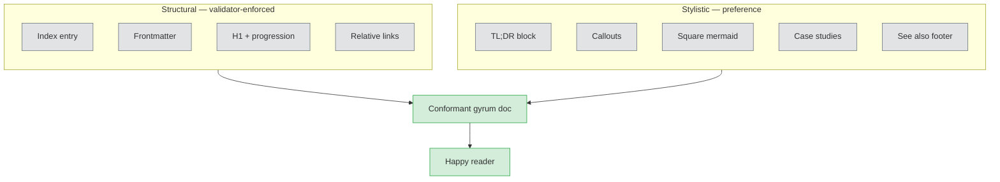

<!-- AUTO-GENERATED from gyrum-labs/devtools docs/shared/doc-standards.md. Do not edit directly. Run scripts/update-docs.sh to refresh. -->

# Documentation standards

## TL;DR

A conformant gyrum doc is registered in `_index.json`, has a single H1 with no skipped heading levels, carries frontmatter if it is living, uses language-tagged fences, and links only to other registered files by relative path. Beyond the structural contract, a *good* gyrum doc reaches for square-aspect mermaid diagrams, alert callouts, case studies pinned to real PRs, TL;DR blocks, quick-reference tables, and a curated "See also" footer — the vocabulary that turns a shared snippet into something a reader actually wants to read.

## Overview

Every gyrum project grows a `docs/` tree, and every gyrum project ships a `docs-viewer/` next to it so that reading the tree is one command away. The two only keep their promises to the reader if the files inside `docs/` follow a shared shape — the sidebar lists every document, the headings form a clean outline, the mermaid blocks render, the links resolve. This document is the contract that defines that shape. It governs the *structural* properties that the viewer and the automated validator care about, and it also collects the stylistic conventions — callouts, diagram shape, case studies, reference tables — that make a gyrum doc read like a computer-studies textbook rather than a wall of unbroken prose. A reader finishing this file should be able to look at any markdown file under `docs/` and answer both "is this a conformant gyrum doc?" and "is it a *good* one?" with confidence.

The contract is written against `docs-viewer/README.md` (which describes how the viewer actually renders files) and `docs/shared/README.md` (which describes how shared snippets are pulled into each project). Read both if you want the full picture of why each rule exists.

The high-level shape of a conformant, well-written gyrum doc looks like this:



Structural rules on the left are machine-checked and block merges. Stylistic guidance on the right is preference rather than gate — the difference between a doc that passes and a doc that a reader actually enjoys.

## Scope

The rules below apply to every markdown file under `docs/` in a consuming project — both hand-authored documents and the auto-generated copies under `docs/shared/`. They do **not** apply to `CLAUDE.md` at the repository root, the top-level `README.md`, any prose embedded in source files (godoc comments, JSDoc, header banners), or release artefacts like `CHANGELOG.md`. Those have their own norms and conventions, and folding them into the same contract would conflate "a doc the viewer renders" with "any piece of writing in the repo". Everything under `docs/` is in scope; everything outside it is out.

## Index registration

Every file under `docs/` must appear in `docs-viewer/_index.json`, because that file is the sole source of truth for what the viewer shows in its left sidebar. A file that is not registered is invisible to the viewer even when it sits two directories away, and an invisible document is effectively undocumented — it has no way to be discovered by a reader who came in through the viewer. The authoritative way to keep the index honest is to let `scripts/update-docs.sh` regenerate it: the script walks the project's `docs/` tree, filters by the allow-listed extensions, and writes out a nested tree sorted directories-before-files and case-insensitively by name. Hand-editing the index is permitted but discouraged, because the same scan runs again the next time anyone refreshes shared docs, and any manual ordering that disagrees with the scan will be overwritten.

The structural validator treats drift between the on-disk tree and `_index.json` as a failure. If you add, rename, or remove a file under `docs/` without running `scripts/update-docs.sh`, the PR will not merge. The fix is a single command.

## Numeric-prefix naming for ordered documents

When a folder under `docs/` contains files that have a natural reading order — a tutorial walked top to bottom, a pipeline described layer-by-layer, a vision → architecture → implementation narrative — the files must be named with a two-digit numeric prefix (`01-`, `02-`, …) or a letter prefix (`A-`, `B-`, …) so the sidebar's alphabetical-by-name sort matches the intended reading order. A folder whose files are *not* ordered — a glossary, a grab-bag of reference pages, a per-persona set of runbooks — is free to use plain names. The distinction is whether a reader is meant to traverse the folder in sequence or pick out the one page they need.

The failure mode this rule prevents is a reader opening the sidebar, seeing `architecture.md`, `broker.md`, `iteration-2.md`, `library.md`, `pipeline-internals.md`, `pipeline.md`, `README.md`, `roadmap.md`, `tooling.md`, `vision.md` in alphabetical order, and starting at `architecture.md` when the author meant them to start at `vision.md`. The 2026-04-24 audit flagged the `ai-research/docs/catalog/` tree as the canonical example — ten files that tell a story, sorted alphabetically into the wrong order.

### The convention

- Two-digit zero-padded prefix: `01-vision.md`, `02-architecture.md`, …, `10-roadmap.md`. Two digits because growing past ten files is common; zero-pad because `2-` sorts after `10-`.
- `README.md` and `_index.md` stay at the root of the folder without a prefix. They are conventionally pinned to the top of the sidebar by most viewers and the numeric entries fall in sequence after.
- If the ordering is primarily chronological (session logs, release notes), prefer a date prefix (`2026-04-24-session.md`) over a sequential number — dates sort naturally.
- Renumber when the order changes rather than leaving gaps. Gaps read as "a file got deleted" to future maintainers; deliberate renumbering with a commit message that explains why is cheaper than the confusion gaps cause.

### When the rule does not apply

- Top-level `docs/` with a handful of task-oriented pages (`README.md`, `OPERATORS.md`, `PATCHER.md`, `PIPELINE.md`) that are entry points, not a sequence. Each stands alone. Prefixing here would imply an order that does not exist.
- Subfolders holding one document per topic with no reading order (`docs/decisions/`, `docs/findings/`, `docs/runbooks/`). These are reference collections; readers arrive by name or search, not by traversal.
- Subfolders where the order is *obvious from the filenames themselves* without prefixes (`setup.md`, `usage.md`, `reference.md` — the English meaning carries the order for small cases). Larger sequences should still prefix because obvious breaks down past about four files.

### Renaming existing folders

Converting an unordered folder to a numeric-prefix folder is a rename + link-update PR. The steps are: pick the order (usually from the folder's own `README.md` table of contents), `git mv` each file to its numbered form, grep the repo for inbound links and update them, re-run `scripts/update-docs.sh` to refresh the index. The structural validator will catch any missed link on the next `gyrum-review-pr` run. Renames read cleanly in `git log --follow` so history is not lost.

## Frontmatter on living documents

Documents in `docs/` fall into two categories: living documents and non-living reference documents. A **living document** is one that tracks decisions, open questions, ongoing work, or anything else that can go stale as the project moves — proposals, design notes, architecture snapshots, findings logs. A **non-living reference document** is one whose content is static: a contract like this one, a shared snippet under `docs/shared/`, an operational runbook that documents an unchanging procedure. The distinction is about the document's relationship to time: if you would expect to revise it when reality changes, it is living; if you would replace it wholesale or leave it alone, it is not.

Living documents must carry YAML frontmatter at the top of the file with at minimum three fields:

```markdown
---
title: Thrunglet — project proposal
status: living document
last-updated: 2026-04-19
---
```

`title` is the human-readable name shown at the top of the rendered view, `status` is a short human-readable label (`living document`, `draft`, `accepted`, `superseded`), and `last-updated` is an ISO-8601 date that tells the reader when the document last matched reality. Non-living reference documents may omit the block entirely. When frontmatter is present, it must be the very first content in the file, bracketed by `---` lines, and every listed field must have a value — an empty field is worse than a missing block because it reads as "nobody cared enough to fill this in".

## The living-document header

<!-- cross-repo path — gyrum-labs/thrunglet; cited as a representative example, resolves in that repo -->
<!-- doc-truth: ignore-next -->
Every living document should open, after the H1, with a blockquote reminder that it is a living document and that the reader is expected to update it when they find gaps. The reason is social rather than technical: readers of a living document are the future editors of it, and a visible reminder at the top of the page is what keeps the decisions log and the open-questions section honest over the course of months. The exact wording is not prescribed, but the shape is — a one-paragraph blockquote, immediately after the H1, calling out that the file is living and inviting the reader to edit it. The opening of `thrunglet/docs/proposal.md` is a representative example:

```markdown
> **This is a living document.** Keep it in sync with reality — if a
> decision changes, or a gap emerges that this doc didn't anticipate,
> update the relevant section (and add to the decisions log).
```

Non-living reference documents do not need this header, because there is nothing the reader would update.

## Heading progression

Each document has exactly one H1, which is the document's own title, and every other heading is H2 or deeper. H2 sections form the outline that a reader skims to decide what to read, and the viewer uses the same outline to offer an in-page table of contents where it can. Skipping a level — jumping from H2 directly to H4, or from H1 directly to H3 — breaks that outline, and it breaks the sidebar's ability to render a sensible hierarchy, so it is not allowed. Go as deep as the content needs, but go one level at a time.

## Code fences and mermaid

Fenced code blocks are the viewer's primary visual device, and every fence should carry a language tag so that highlight.js can colour it correctly. An untagged fence renders as monospace plain text, which is a usability regression for no good reason — if the content is JSON, say `json`; if it is bash, say `bash`; if it is genuinely prose that happens to need monospace, say `text` so the intent is explicit. The viewer recognises the normal set of language tags that highlight.js ships with; there is no project-specific allow-list.

Mermaid diagrams are a special case. A fenced block whose language tag is `mermaid` is handed to mermaid.js and rendered as an SVG diagram inline. Mermaid is the preferred notation for flows, state machines, sequence diagrams, and any other structural picture that would otherwise be drawn in a screenshot. A mermaid block is versionable text, diffs cleanly in review, and renders identically in every viewer instance; a pasted screenshot is none of those things. Reach for mermaid first, and only fall back to an image when the shape genuinely is not expressible as a mermaid diagram.

## Icons in docs

Icons are welcome but earn their place. They're glyphs with meaning, not decoration. Every icon should be answering a question a reader might otherwise have to infer from prose.

### Where icons belong

- **Callout labels** — paired with the callout type (📖 case study, 🧪 example, 🎯 try this, 🕳️ deep dive, ⚠️ pitfall, 🔖 glossary). These are the canonical set; don't invent new ones per doc.
- **Mermaid diagram nodes** — when the node represents a real UI affordance (⚙ settings, ✏ edit, 🔒 locked) or a system role (🤖 agent, 👤 human, 📦 service). Use ascii-ish characters or unicode symbols, not emoji, when the diagram may render in terminals.
- **Section markers for repeated structural elements** — e.g. "## 🧪 Worked example:" as an H2 consistently through a tutorial document. Consistency matters more than variety.
- **Status / state indicators in tables** — ✓ done, ⏳ in progress, ✕ blocked, — n/a. Prefer these over words like "yes"/"no"/"pending" for dense reference tables.

### Where icons do NOT belong

- **H1 titles** — keeps the sidebar list clean and greppable.
- **Decorative flourishes in prose** — 🚀 to mean "fast", 💡 to mean "idea". The prose should carry the meaning.
- **Every bullet point** — reads as noise.
- **Replacing a word** — icons supplement, not substitute. "Deploy 🚀 the service" is worse than "Deploy the service."

### Icon vocabulary (canonical set)

Use these consistently across docs so readers build intuition:

| Icon | Meaning |
|---|---|
| 📖 | Case study (real past incident/PR) |
| 🧪 | Worked example (code + output) |
| 🎯 | Try this (actionable step) |
| 🕳️ | Deep dive (optional tangent) |
| ⚠️ | Pitfall (common mistake) |
| 🔖 | Glossary (inline term definition) |
| ✓ | Done / passed |
| ⏳ | In progress / waiting |
| ✕ | Blocked / failed |
| — | Not applicable |
| 🤖 | Agent / automation |
| 👤 | Human / operator |
| 📦 | Service / component |
| 🔒 | Gated / requires approval |
| 📍 | "You are here" in a flow |

### Accessibility

Every icon paired with text — the icon is the visual affordance, the text is the semantic content. A screen reader user should understand the doc just as well without the icons. If an icon is alone (rare), include a `title` attribute or prose fallback.

### Terminal renderability

Some icons don't render in terminal viewers (Unicode fallbacks vary). For docs that might be read via `less` or `cat`, stick to ASCII-compatible glyphs: ✓ ✕ — + -. The emoji callout set IS allowed in the viewer-rendered docs because gyrum-docs-viewer guarantees emoji support, but be conservative in any file likely to be grepped or piped to a terminal.

## UI screenshots

<!-- consumer may not yet have docs/userguide.md — scaffolded by setup-project for UI-shipping repos -->
<!-- doc-truth: ignore-next -->
Projects that ship a user-facing UI must include screenshots of the primary screens in `docs/userguide.md` (and optionally the top-level `README.md`). At minimum: the empty-state and populated-state of each primary workflow screen, plus one completed example of the main output the product produces. Host the images under `docs/images/` in the repo so they version and diff alongside the code rather than living on an external host.

Screenshots complement the mermaid-first rule for diagrams; they are the right choice for showing *what a screen actually looks like*, where mermaid is the right choice for *what a flow looks like*. Projects with no UI — libraries, CLIs, backend-only services — are exempt.

## PR functional and visual evidence

Keep evidence inside the existing PR `## Verification` section. Production UI screen/rendering changes require a renderable image, mockup or functional preview. Backend API, data, state or authority changes require a small relevant flow, sequence or state diagram and an explanation of the changed boundaries. Root and nested module paths count alike. Mixed changes need both; UI-only needs no backend diagram and backend-only needs no screen preview. Documentation, tests, fixtures and unrelated scripts need neither visual shape; existing execution requirements for other work types still apply.

Each UI record uses `visual-kind`, `artifact`, `route` or `function`, `scenario`, `source` and `caption`. Choose exactly one honest kind: **design mockup**, **local compiled preview** or **deployed screenshot**. Name the actual full source commit SHA and explain what the artifact shows. A design mockup must not claim runtime or deployment success.

Local artifact paths must stay within the repository, exist and match `artifact-sha256`; their source must match the checked-out HEAD. A remote image or functional-preview record is **supplied-not-fetched**: the offline predicate never fetches its URL or verifies its contents, rendering or relevance. Formal reviewers judge relevance; a well-formed link alone is not verified visual content.

The following shapes are templates, not evidence. Fill every field from actual artifacts; placeholders, example graphs and bare test-spec filenames cannot satisfy the requirement. Keep each record's fields together under its H3.

````markdown
### UI evidence
visual-kind: local compiled preview
artifact: 
route: <route shown; use function instead when appropriate>
scenario: <state or interaction shown>
source: <full actual source commit SHA>
caption: <what this shows>
artifact-sha256: <actual local file SHA256>
````

For backend evidence, use `backend-diagram` with real Mermaid flowchart/graph, sequence or state relationships and a `boundary` explanation. An API diagram accompanies its existing curl execution evidence; a diagram alone is explanatory evidence and never runtime proof. Preserve any other required migration, CI or CLI execution evidence.

````markdown
### backend-diagram
boundary: <which API, data, state or authority boundaries changed>

```mermaid
<actual flow, sequence or state relationships>
```
````

Generated recommendations remain visibly incomplete until filled. Seeding preserves author-written sections and is idempotent. This forward amendment leaves historical evidence meanings, advisory/enforce modes and audited exemptions unchanged; it grants no installation, protection or activation authority.

## Links

<!-- the absolute-path token is cited as a non-compliant example; it intentionally does not resolve -->
<!-- doc-truth: ignore-next -->
Internal links between documents must be relative paths to files that are themselves registered in `_index.json`. A link like `[the gate stack](./gate-stack.md)` resolves correctly inside the viewer because the target is a sibling document that the index knows about; a link like `/docs/shared/gate-stack.md` or a bare `gate-stack.md` without the relative prefix does not, because the viewer serves from one directory above `docs-viewer/` and absolute-style paths escape that root. Linking to an unregistered file is equivalent to linking to nothing — the viewer may load the file if the path happens to resolve, but the reader has no way to navigate to it through the sidebar, which defeats the point. The validator treats both categories — non-relative internal links and links to unregistered files — as broken, and a broken link is a merge blocker.

External links to the public internet are unrestricted. Use them freely where they point at authoritative upstream references.

## Placeholder content

<!-- consumer may not yet have these scaffold paths — scripts/setup-project.sh, docs/proposal.md, docs/userguide.md are dropped by gyrum-setup, not assumed pre-existing -->
<!-- doc-truth: ignore-next -->
`scripts/setup-project.sh` drops template documents — `docs/proposal.md` and `docs/userguide.md` — into every new project so that the structural shape is present from day one. A template is a prompt to fill out, not a document to merge. A PR that lands a template-seeded doc whose content is still the template's own prose, with no project-specific content, is a failure: the doc claims to describe the project but in fact describes no project in particular, and letting it merge poisons the `docs/` tree with documents that look populated but are empty. The validator compares each template doc against the seed text and fails the PR when the match is too close. The fix is to write the document — the presence of the template is the starting point, not the finish line.

## Architectural decision records (ADRs)

Architecturally-significant changes must be accompanied by an Architectural Decision Record in the repository where the change lands. An ADR is a short, immutable note that captures a single decision, the context that forced it, the alternatives that lost, and the consequences the team accepts by taking it. The purpose is historical: six months from now someone should be able to reconstruct *why* the system looks the way it does from nothing but the repo — no Slack archaeology, no tribal memory, no ad-hoc reconstruction from a half-remembered thread. ADRs are the shape that record takes across every gyrum project, so that the reasoning behind one project's design is legible to someone arriving from another.

An ADR is required when the change is any of the following: a new component, service, or library that other code will depend on; a public API change that will outlive a single PR (signature, protocol, on-wire format); a security-relevant choice (authn/authz model, secret handling, redaction, trust boundary); an infrastructure change that constrains future deploys (new stack component, storage engine, runtime dependency); or a cross-cutting pattern that multiple services are expected to adopt (logging shape, error taxonomy, probe contract). A bug fix, a refactor, a dependency bump, or a piece of internal plumbing that could reasonably be reverted without stakeholder discussion does not need an ADR — the bar is "a future architect or security reviewer needs to understand why we chose this", not "we changed code".

ADRs live at `docs/decisions/` in the repository where the change lands. File names use a zero-padded three-digit number followed by a short kebab-case slug: `007-redaction-phase-1-and-phase-1-5.md`. To number a new record, find the highest existing `NNN-` prefix in that directory and increment by one. Numbers are never reused — even a superseded record keeps its slot, because the slot is part of the historical trail the ADR set exists to preserve.

Every ADR uses [Michael Nygard's template](https://cognitect.com/blog/2011/11/15/documenting-architecture-decisions) exactly. Four sections, in order: **Context** (the forces at play, why this needs a decision *now*), **Decision** (one crisp sentence in present tense, then the shape), **Consequences** (what becomes easier, what becomes harder, what we have signed up to operate), and **Alternatives considered** (each option with one or two lines on why it lost). Missing sections are a merge blocker. Each record carries a Status line (`Proposed`, `Accepted`, `Superseded by NNN`, `Deprecated`) and a Date line in ISO-8601. The target length is 60–120 lines; hard bounds are 40 and 150.

ADRs are **immutable once accepted**. They are a historical record of what we chose and why at the time. If a later decision reverses an earlier one, write a new ADR — do not rewrite the old one. In the superseded record, change only the Status line to `Superseded by NNN` and add a one-line pointer to the new record; the Context, Decision, Consequences, and Alternatives stay as they were on the day the decision was made, because rewriting them erases the history the ADR exists to preserve. Typo fixes, broken-link repairs, and adding cross-references to later ADRs are fine; anything that changes the meaning is not.

When an ADR references code or docs in another gyrum repo, link by GitHub URL, not by bare filename — the file tree of the other repo is not visible from the reader's position, and a bare filename is an invitation to a stale link. When a decision in one repo is implemented in another (the most common case for library-shaped decisions), the ADR lives where the decision was made and the stakeholders are; a pointer from the implementing repo's README back to the ADR URL closes the loop.

Enforcement is advisory for now. `gyrum-review-pr` will warn — not block — on architecturally-shaped PRs that land without an ADR; the warning is the placeholder for a linter that lands in a future devtools PR. Until then, the rule is a review-time convention, and the three-persona review expects it to be applied.

## Mermaid diagrams — shape guidance

Mermaid is the project's default diagram notation (see §Code fences and mermaid for why), but *any* diagram that sprawls off the edge of a sidebar viewer hurts more than it helps. The reader's canvas is narrow — especially on mobile or in the GitHub preview pane — and a diagram that forces horizontal scrolling is a diagram the reader will skip. Prefer a roughly square aspect ratio, between 4:3 and 1:1, so the picture lands on the page as a picture rather than a ribbon.

A set of rules of thumb falls out of that constraint:

- **Prefer `flowchart TB`** (top-bottom) for short chains of up to about seven nodes. Vertical flows stack cleanly inside a narrow reading column.
- **Switch to `LR`** (left-right) only for genuinely linear pipelines of three to five steps. Beyond five, `LR` overflows the sidebar and becomes scroll-bait.
- **Break up the diagram when it gets big.** More than about seven nodes is a hint to introduce a `subgraph` cluster or to split into two diagrams linked by prose. A tall column of more than ten rows should split. A wide row of more than five siblings should rotate to `TB` or split.
- **Colour-code with `classDef`.** A flat monochrome diagram reads as a wiring schematic; a diagram with a small, consistent palette reads as a *picture* that the reader can orient inside. Reuse this palette across docs so readers build up muscle memory for what each colour means:

  ```text
  classDef success fill:#d4edda,stroke:#28a745
  classDef warning fill:#fff3cd,stroke:#ffc107
  classDef error   fill:#f8d7da,stroke:#dc3545
  classDef neutral fill:#e2e3e5,stroke:#6c757d
  ```

- **Cap sequence diagrams at four participants.** More than four and the swim-lanes run off the side; split into a Phase 1 / Phase 2 pair of diagrams instead.
- **Annotate every edge in a state diagram with the triggering event.** An unlabeled transition breaks the "what caused this transition" story the diagram exists to tell.
- **Provide a text alternative for complex diagrams.** One paragraph of plain-English summary below the diagram lets a reader whose mermaid render failed — or who is skimming on a phone — still get the gist.

> [!TIP]
> When in doubt, start with `flowchart TB`, seven nodes max, and one `classDef` applied to the two or three nodes the reader should focus on first. You can iterate from there; you rarely regret the square-aspect starting point.

The demonstration diagram at the top of this document is a worked example of the guidance in this section: `flowchart TB`, two `subgraph` clusters, fewer than ten nodes total, and `classDef` used to distinguish "machine-checked" from "stylistic" from "outcome" nodes.

## Callouts and info blocks

Prose is a linear medium, and some of the most important things a document has to say — a footgun, a pointer to a case study, a shortcut the reader will thank you for — want to break out of the line. GitHub-flavoured alert syntax is the project's default for these, because every viewer renders it natively and GitHub itself renders it inline on PR previews and file views:

```markdown
> [!NOTE]
> Side information that helps understanding but isn't critical.

> [!TIP]
> A shortcut, pattern, or convention that makes life easier.

> [!IMPORTANT]
> The reader needs to know this before doing anything else.

> [!WARNING]
> Potential footgun — easy to get wrong, consequences non-trivial.

> [!CAUTION]
> Destructive if done wrong. Stop and think before proceeding.
```

Beyond the five native alerts, a small set of gyrum-specific callouts using a nested blockquote plus a bold emoji-prefixed label covers the patterns that turn up repeatedly in our docs. The emoji come from the canonical icon vocabulary in §Icons in docs — do not invent new ones per document:

```markdown
> **📖 Case study —** A PR, incident, or design that illustrates the point.
> Pin these to real things that happened; they age well precisely because
> they are factual.

> **🧪 Example —** A worked example, usually code plus its output.

> **🎯 Try this —** An action the reader can take right now to experience
> what the doc describes.

> **🕳️ Deep dive —** Optional tangent for readers who want more. Signal
> that the reader can skip without losing the thread.

> **⚠️ Pitfall —** A specific mistake repeatedly made in this area. Name
> the mistake, name the fix.

> **🔖 Glossary —** Inline term definition. Use when a technical term
> appears for the first time and is not already in the global glossary.
```

The two notations compose: a `[!NOTE]` for "here's a fact the reader should be aware of" and a `**📖 Case study —**` for "here's a PR that grounds the fact in history" sit next to each other without fighting, because they answer different questions.

> **📖 Case study —** An audit of project docs on 2026-04-24 found thirty-three distinct empty-state strings across the `docs/` tree — "nothing yet", "TBD", "coming soon", "—", and so on — with no consistent grammar, which is what prompted ADR-081's empty-state grammar. The lesson is that prose conventions drift by default, and a standards document that names the convention and gives the reader a copy-pasteable shape is the cheapest intervention that makes the drift stop.

> [!WARNING]
> Do not stack more than two callouts in a row. A page that is three-quarters callouts is a page whose author could not decide what was important; the reader ends up treating all of them as noise.

## Case studies and worked examples

The two shapes — case study and worked example — do different jobs and should not be confused:

- A **case study** is "this really happened and you can learn from it." Every case study cites a concrete PR or incident URL and closes on a one-sentence takeaway. Case studies age like fine wine because they are anchored to history — the PR number does not drift, the incident did not unhappen, and a reader six months from now can trace the reasoning back to the code that caused it.
- A **worked example** is "here's what this looks like." Usually code plus its expected output. Tag the output fence as `text` so the reader can tell at a glance that it is output and not input; if the example is a command, show the command in `bash` and the output in `text`.

Doc authors should aim for at least one case study *or* worked example per major concept. This is a rule of thumb, not a hard gate — some concepts are genuinely self-evident and need no illustration — but the rule of thumb is a useful default because the moment a reader sees a concept grounded in a real PR or a runnable snippet, their brain switches from "abstract text" to "thing I can reason about". The point of the ratio is not to hit a number; it is to keep the doc from becoming an unrelieved slab of prose.

**🧪 Example —** The §Links rule says internal links must be relative paths to registered files. A compliant link and two non-compliant variants, side by side:

```text
Good: [the gate stack](./gate-stack.md)
Bad:  [the gate stack](/docs/shared/gate-stack.md)   # absolute — escapes viewer root
Bad:  [the gate stack](gate-stack.md)                # bare — no ./ prefix
```

## TL;DR block at document start

Living documents longer than about two hundred lines should open — after the frontmatter, the H1, and the living-document header — with a short `## TL;DR` section that captures the decision or shape of the document in two to three sentences. The reader who has ten seconds before their meeting starts should come away with the headline even if they never scroll past the first screen.

This is a preference, not a gate: the validator does not check for it. Short documents, reference tables, and ADRs (which have their own structural shape) do not need it. For everything else, a TL;DR is the single cheapest intervention that improves a doc's usefulness — the author has to decide what the point *actually* is, and the reader gets the answer without paying the cost of reading the whole file.

The TL;DR at the top of this document is itself an example.

## Quick-reference tables

Dense reference material — API shapes, status enum values, path conventions, command tables — belongs in a markdown table, not in prose. If the reader's primary intent is "remind me what the shape of X was", a table beats three paragraphs of explanation every time; the prose version is hostile to the reader's actual goal, which is to scan.

The rule of thumb is this: if the content reads naturally as "X does Y, and Z does W, and Q does V", it is a table. Promote it. The icon vocabulary in §Icons in docs and the file list in `docs/shared/README.md` are both worked examples of this pattern — every reader of those sections arrives with a lookup intent, and a table is the shape that intent wants.

A compact "which tool for which reader intent" reference:

| Reader intent | Use |
|---|---|
| "What do I need to do?" | Imperative prose, ordered list |
| "What does this *mean*?" | Explanatory prose |
| "What was X's shape again?" | Quick-reference table |
| "How does the flow go?" | Mermaid diagram (square aspect) |
| "What really happened that time?" | Case-study callout |
| "Can I skip this bit?" | Deep-dive callout |

## "See also" footer

Every doc that names a cousin concept — another ADR, another playbook, another shared snippet, another primitive — should close with a short `## See also` section listing three to five cross-references. Not a dump of every link mentioned in the document; the three-to-five the reader is most likely to want to read *next*.

The constraint is deliberate. A curated footer of the most useful next-reads is a feature; an exhaustive dump of every hyperlink in the doc is noise. If you cannot narrow your "See also" to five items, the doc is probably covering too much and should be split.

## Non-goals

This document does not regulate prose voice, word count, or the tone of any given doc — consuming projects and their authors are free to choose what works for them. It does not prescribe a fixed outline for living documents, because different kinds of living documents need different shapes. It does not cap the number of documents in `docs/`, cap file size, or ban duplication between a doc and its source code. The structural rules at the top of this file are enforced mechanically; the stylistic guidance in the middle is preference; everything above that line is left to the author's judgment.

## See also

- [`docs/shared/README.md`](./README.md) — why `docs/shared/` exists and how content reaches consuming projects.
- [`docs/shared/gate-stack.md`](./gate-stack.md) — the structural validator that enforces the rules in the first half of this document.
- [`docs/shared/workflow-boilerplate.md`](./workflow-boilerplate.md) — the developer loop inside which doc PRs get opened, reviewed, and merged.
- [`docs/shared/check-stack.md`](./check-stack.md) — the full four-layer check stack, of which the doc-standards validator is one layer.
